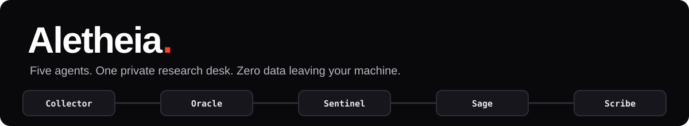
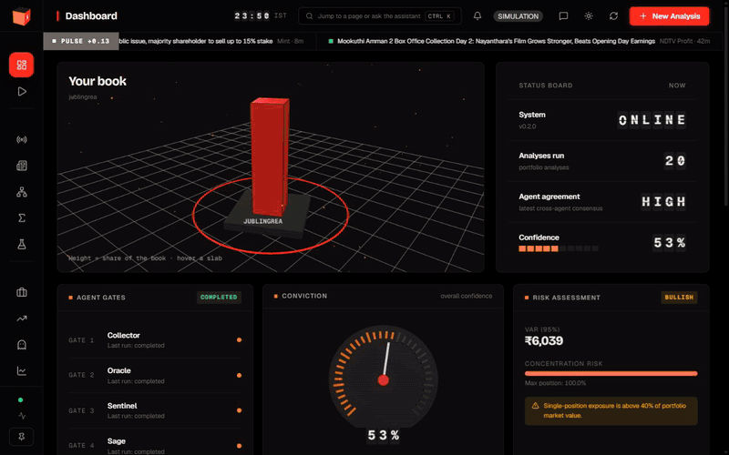
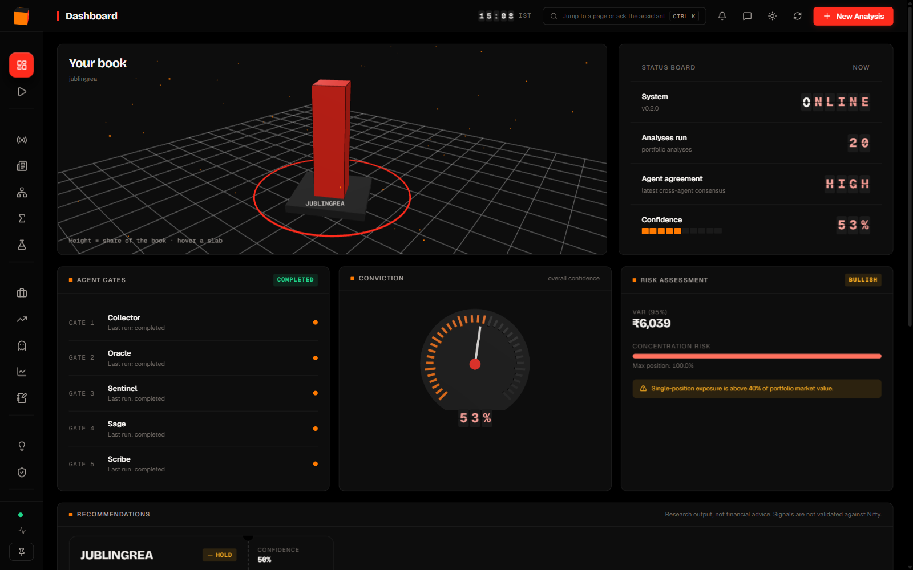
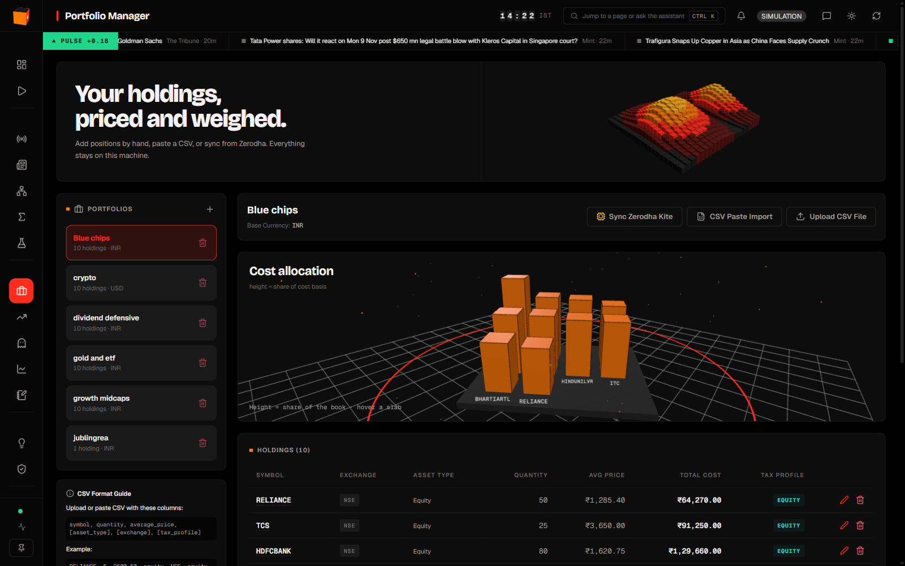
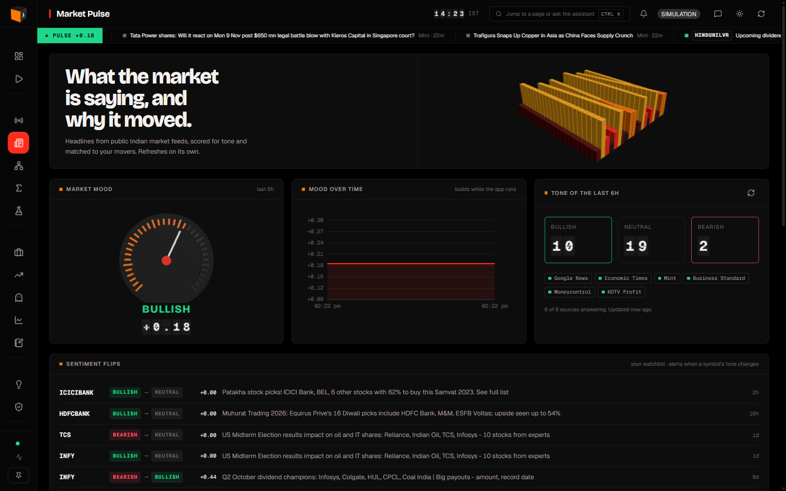
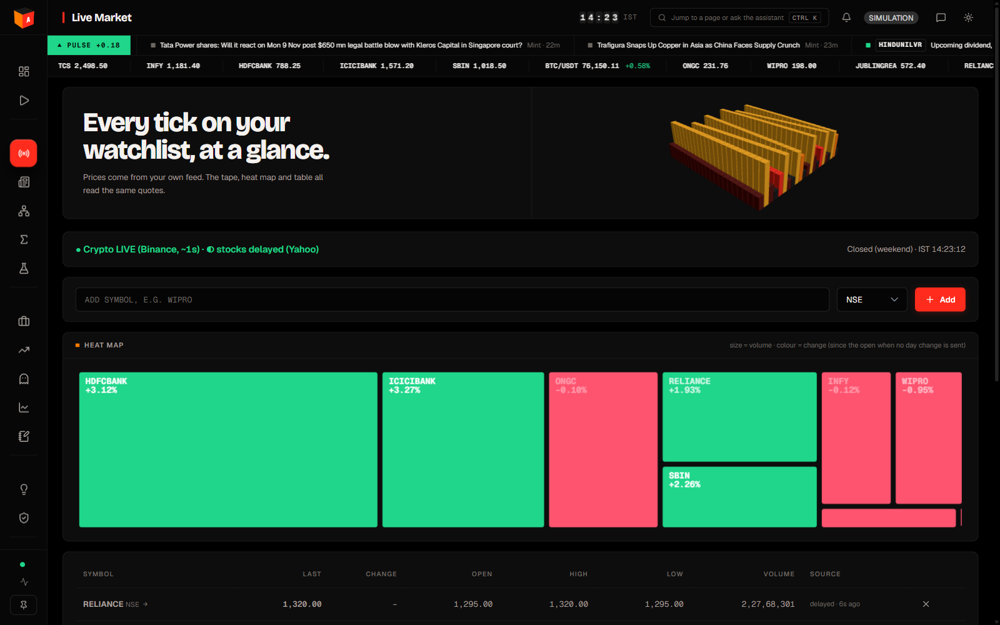
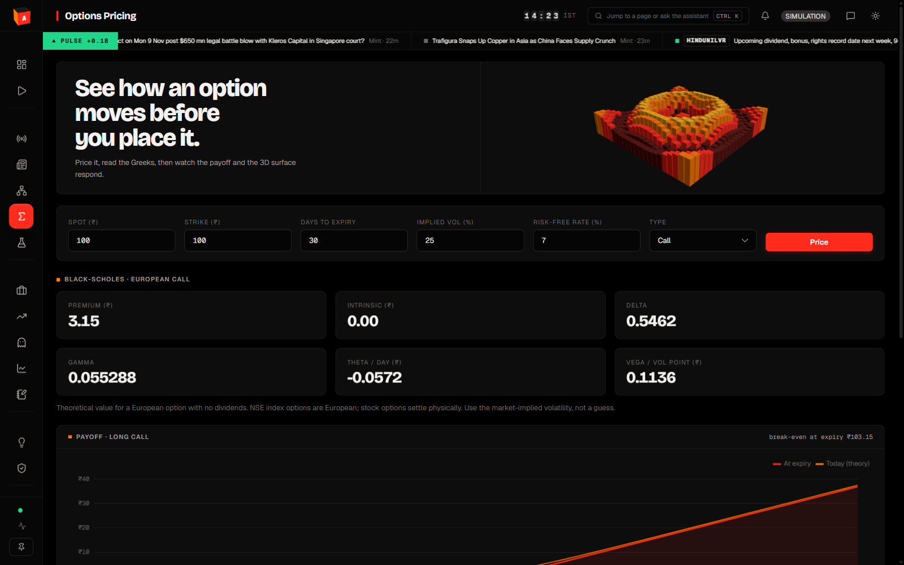
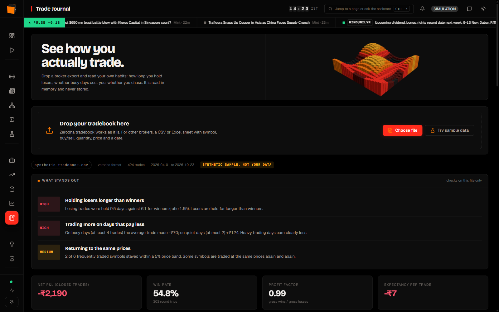
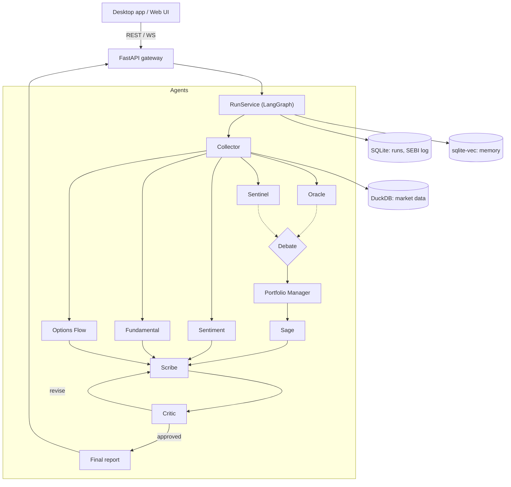

<p align="center"></p>

<h1 align="center" hidden>Aletheia</h1>

<p align="center">
  <a href="https://github.com/AbsSadhu/Aletheia/actions/workflows/ci.yml"></a>
  <a href="https://github.com/AbsSadhu/Aletheia/releases/latest"></a>
  <a href="LICENSE"></a>
  
  
  
  
  
  <a href="https://github.com/AbsSadhu/Aletheia/issues?q=is%3Aopen+label%3A%22good+first+issue%22"></a>
  <a href="https://github.com/AbsSadhu/Aletheia/stargazers"></a>
</p>

<p align="center"><strong>A private research desk for Indian stocks and crypto.</strong><br>
Multi-agent portfolio analysis, honest backtests, paper trading and live market views, all running on your own machine.</p>

<p align="center">
  <a href="https://github.com/AbsSadhu/Aletheia/releases/latest"><b>Download</b></a> &nbsp;·&nbsp;
  <a href="docs/USER_GUIDE.md">User guide</a> &nbsp;·&nbsp;
  <a href="CHANGELOG.md">Changelog</a> &nbsp;·&nbsp;
  <a href="https://github.com/AbsSadhu/Aletheia/issues">Issues</a> &nbsp;·&nbsp;
  <a href="CONTRIBUTING.md">Contribute</a>
</p>

<p align="center"></p>
<p align="center"><sub>A real tour of the desktop app: dashboard, a finished run, Market Pulse, Live Market, options and the trade journal.</sub></p>

https://github.com/user-attachments/assets/39a24fea-bf83-4781-b802-388593a09520

<p align="center"><sub>An 84-second walkthrough. <a href="https://github.com/AbsSadhu/Aletheia/releases/download/v0.2.0/Aletheia-walkthrough.mp4">Download the 1080p version</a> &middot; music: &ldquo;Perfect Crime&rdquo; by Gvidon, via Pixabay</sub></p>

**Aletheia** brings a team of specialised agents, fast Rust maths and your local language models together in one desktop app. Add your holdings, press **New Analysis**, and watch the Collector, Oracle, Sentinel, Sage and Scribe work through them live: market data, a deterministic factor signal, Value-at-Risk, India-specific STCG/LTCG tax scenarios, and a written synthesis that is audited before you see it. Your portfolio never leaves your computer.

> **Research tool, not financial advice.** Aletheia's signals, risk figures and tax scenarios are generated by models and heuristics, are for information and education only, and are not a recommendation to buy or sell anything. It starts in simulation mode; the optional live-order path is off by default and guarded (see [Live data & broker orders](#live-data--broker-orders)). Consult a SEBI-registered adviser before acting. See the [LICENSE](LICENSE) for the warranty disclaimer.

---

## Why Aletheia

- **Private by design.** Your holdings, runs and journal live in a folder on your own machine. No account, no cloud, no telemetry.
- **Built for India.** NSE/BSE tickers, STCG/LTCG tax scenarios, Indian trading costs, and news from Indian feeds out of the box.
- **Honest about what works.** The app backtests its own signal against Nifty and shows you the result, whatever it is.
- **Agents with guard rails.** Each agent has a strict role contract; one deterministic node enforces size and exposure limits, and every recommendation goes into a tamper-evident log.
- **Free to run.** Works without any API key. Add a local model through Ollama for chat and written commentary if you like.

---

## Contents

[Install](#install) · [What you can do](#what-you-can-do) · [Screenshots](#screenshots) · [How it works](#how-it-works) · [Run from source](#run-from-source) · [Live data & broker orders](#live-data--broker-orders) · [Good to know](#good-to-know) · [FAQ](#faq) · [Developer guide](#developer-guide) · [Community](#community) · [Contributing](#contributing) · [Security](#security) · [License](#license)

---

## Install

### Windows desktop app (recommended)

1. Open the **[latest release](https://github.com/AbsSadhu/Aletheia/releases/latest)** and download `ALETHEIA_<version>_x64-setup.exe` together with `SHA256SUMS.txt`.
2. **Check the download** (takes a few seconds). In PowerShell, from the folder you downloaded to:

   ```powershell
   Get-FileHash .\ALETHEIA_*_x64-setup.exe -Algorithm SHA256
   ```

   The hash must match the line for that file in `SHA256SUMS.txt`.
3. Run the installer. The installer is not yet code-signed, so Windows SmartScreen may show *"Windows protected your PC"*. After you have checked the hash above, choose **More info → Run anyway**.
4. Launch **ALETHEIA** from the Start menu. It starts its own analysis engine and opens when ready. No account and no API keys are needed.

Everything is stored locally, in a `data` folder inside the app's install folder (`resources\aletheia-backend\data`). Uninstall at any time from *Settings → Apps*; your data is left in place, so reinstalling to the same folder picks up where you stopped.

**Optional: a local AI model for the chat assistant and written commentary.** Install [Ollama](https://ollama.com), then run `ollama pull mistral:7b`. Without a model, every page and every agent run still works; the assistant simply needs a model (or a cloud key) to chat. You can also point Aletheia at OpenAI, Anthropic or Gemini in **Settings**.

### Other ways to run it

- **From source:** see [Run from source](#run-from-source).
- **Docker:** `docker compose up` starts the backend, the Rust compute engine, the web UI and an Ollama container. Prometheus and Grafana are opt-in with `docker compose --profile observability up`.

---

## What you can do

| | |
| :-- | :-- |
| **Analyse a portfolio** | Add holdings by hand, paste or upload a CSV ([sample](docs/sample_portfolio.csv)), or sync from Zerodha Kite. One click runs the full agent pipeline and streams every step. |
| **Read the results** | Per-symbol signals, portfolio VaR and concentration, STCG/LTCG tax-aware scenarios, sentiment, fundamentals and options flow, and a synthesised BUY / HOLD / REDUCE view with confidence, stop-loss and target. Export any run as **PDF or Excel**. |
| **Follow the market** | **Market Pulse** scores headlines from public Indian news feeds and tracks the mood, per-symbol tone and tone flips. **Live Market** shows a heat map and tape of your watchlist, with per-second crypto from Binance (no account). |
| **Test before you trust** | **Backtest** strategies with realistic Indian costs and capital-gains tax. **Signal Validation** pits the Oracle's signal against Nifty after costs and tax, with significance checks, so you can judge it on evidence. |
| **Practise safely** | **Shadow Trader** turns signals into virtual trades with a live equity curve; **Paper Trades** lets you place and settle your own simulated orders. |
| **Understand yourself** | **Trade Journal** reads a broker export (Zerodha tradebook works as-is) and surfaces habits: holding losers longer than winners, trading more on days that pay less, buying after run-ups, and returning to the same prices. It is processed in memory and never stored. |
| **Explore ideas** | **Factor Explorer** (RSI, MACD, Bollinger, volume), **Options Pricing** (Black-Scholes, Greeks, a 3D surface), **Correlation** regimes, and a **Hypotheses** board that auto-evaluates ideas against a backtest. |
| **Ask the assistant** | A tool-using chat panel (`Ctrl+K` to jump anywhere, `Ctrl+J` to chat) that can fetch prices, run technicals, backtest and inspect your portfolio. Any order it proposes needs your explicit confirmation. |
| **Automate** | A full `aletheia` CLI and terminal dashboard, plus an **MCP server** (`aletheia mcp`) so Claude Desktop or Cursor can use the same tools. |

---

## Screenshots

All captured from the running desktop app.

<p align="center"></p>
<p align="center"><em>Dashboard: your book in 3D, the five agent gates, an overall-conviction gauge and the risk read-out.</em></p>

<p align="center"></p>
<p align="center"><em>Portfolio manager: CSV import, Zerodha sync, inline edits and a 3D cost-allocation view.</em></p>

<p align="center"></p>
<p align="center"><em>Market Pulse: the news mood, tone counts by source, and per-symbol sentiment flips.</em></p>

<p align="center"></p>
<p align="center"><em>Live Market: tape, heat map and table for your watchlist. Crypto streams live; stocks are labelled as delayed unless you connect a broker.</em></p>

<p align="center"></p>
<p align="center"><em>Options Pricing: premium and Greeks, a payoff chart and a 3D surface.</em></p>

<p align="center"></p>
<p align="center"><em>Trade Journal: drop a broker export (or try the labelled sample) and see what stands out.</em></p>

---

## How it works

### Meet the agents

1. **Collector**: normalises NSE/BSE tickers, fetches quotes through a provider fallback chain, logs provenance.
2. **Oracle**: a deterministic factor-composite signal from daily price history with walk-forward-calibrated confidence and ATR-based stop and target. The language model only explains it.
3. **Sentiment**: scores headlines and corporate announcements with a transparent keyword method.
4. **Fundamental**: pulls valuation multiples and promoter holding and compares P/E with the sector.
5. **Options Flow**: reads NSE option chains for put-call ratio, IV rank and max-pain levels.
6. **Sentinel**: portfolio VaR (95%) and market regime from a Rust-backed hidden Markov model.
7. **Sage**: India-specific STCG/LTCG tax projections, so you see returns after tax.
8. **Scribe**: synthesises every output into one report and flags gaps and disagreements.
9. **Critic**: audits the Scribe's report and can send it back for revision.

A **Debate** node re-prompts Oracle and Sentinel when they disagree, and a deterministic **Portfolio Manager** node enforces exposure and size limits, with any override recorded.



### Role contracts keep agents in their lane

Agents inherit a strict Pydantic contract, enforced when the class is defined and again at runtime: **Analysts** may only emit data, signals and confidence; **Risk** agents apply limits and tax drag; the **Synthesis** agent writes the narrative. No agent can both invent data and make the decision.

### Built to be trusted

- **Append-only SEBI log** of every recommendation, with database triggers and a SHA-256 hash chain so tampering is detectable (`GET /api/v1/compliance/verify`).
- **Encrypted at rest** run state, per-node timeouts, partial-failure handling (a report with data gaps instead of a failed run), and rate limiting.
- **Honest by design:** the app tests its own signals against Nifty (Signal Validation) and reports the outcome plainly, so it works best as a research and learning companion, not an autopilot.

### Tech stack

| Layer | Technology |
| :-- | :-- |
| Agent core | Python 3.13, FastAPI, LangGraph, Pydantic v2 |
| Performance | Rust: a PyO3 extension (`aletheia_rust`) and an Axum sidecar (`aletheia_engine`); `ComputeClient` falls back automatically if the sidecar is offline |
| Data | SQLite (state), DuckDB (market data), sqlite-vec (memory) |
| Frontend | React 19, TypeScript, Vite, three.js and ECharts; 17 pages; light and dark themes |
| Desktop | Tauri 2: bundles a frozen backend and the Rust engine, starts them for you, native notifications and `aletheia://` links |
| Models | Ollama locally (`mistral:7b` by default), or OpenAI, Anthropic, Gemini |

---

## Run from source

**You need:** Python 3.13 with [Poetry](https://python-poetry.org), Node.js 20, and the [Rust toolchain](https://rustup.rs) (on Windows, with the Visual Studio C++ Build Tools).

```powershell
# 1. Python environment and the Rust extension
poetry install
poetry run pip install maturin
cd aletheia_rust; poetry run maturin develop; cd ..

# 2. Optional first-time configuration wizard
poetry run aletheia config init

# 3. Backend (port 8899)
poetry run uvicorn aletheia.core.main:app --port 8899

# 4. Frontend in a second terminal (http://localhost:5173)
cd frontend; npm ci; npm run dev
```

Prefer the desktop shell while developing? `cd desktop; npm ci; npm run tauri dev`.

**Build the installer yourself** (freezes the backend, stages the Rust engine, builds the frontend and the Tauri bundle):

```powershell
powershell -ExecutionPolicy Bypass -File desktop\scripts\rebuild_desktop.ps1
# -> desktop\src-tauri\target\release\bundle\nsis\ALETHEIA_<version>_x64-setup.exe
```

Prefer a terminal? `poetry run aletheia tui` drives the same backend from a text dashboard.

Copy `.env.example` to `.env` to change ports, paths, models or feeds; every setting is documented there.

---

## Live data & broker orders

- **Crypto, free, per-second:** any pair on your watchlist (for example `BTC/USDT`, exchange `BINANCE`) streams from Binance's public WebSocket with no key or sign-up. Switch it off with `ALETHEIA_CRYPTO_STREAM_ENABLED=false`.
- **Indian stocks:** quotes default to Yahoo (delayed) and are labelled as such. For about one update per second, connect **Angel One SmartAPI** (free; [setup guide](docs/ANGEL_ONE_SETUP.md)) or **Fyers** ([setup guide](docs/FYERS_SETUP.md)). A free, unofficial BSE-website poller is also available; see [docs/FREE_LIVE_DATA.md](docs/FREE_LIVE_DATA.md) for what was tested and why.
- **Zerodha:** *Settings → Connect Zerodha* runs Kite's OAuth login (the daily token is stored encrypted and expires each morning) and syncs real holdings. Register `http://127.0.0.1:8899/api/v1/brokers/zerodha/callback` as the redirect URL in your Kite app.
- **Live orders are off by default.** An order is sent only if *all* of these hold, checked before any network call: `ALETHEIA_LIVE_TRADING_ENABLED=true`; API-key auth configured; execution mode `live` and not paused (going live requires paper trades on at least 7 distinct days, measured from your own history); `confirm: true`; whole-share quantity within `ALETHEIA_LIVE_MAX_ORDER_QTY` (500), value within `ALETHEIA_LIVE_MAX_ORDER_VALUE` (₹25,000) and at most 10 orders a day; NSE/BSE delivery equity with MARKET or LIMIT only. There is deliberately no UI button for it. The broker integrations are tested against mocked services, so if you enable them, start with one share and a tiny limit order.

---

## Good to know

- **Simulation first.** The app opens in simulation mode and everything works without any account or key.
- **Stock data speed.** Without a broker connection, Indian stock quotes are delayed; the app says so on screen.
- **Local models.** A large model on modest hardware can exceed the default per-agent timeout (120 s). Raise `ALETHEIA_NODE_TIMEOUT_SECS` if a run comes back `partial` with nothing actually broken.
- **Unsigned installer.** Until the installer is code-signed, Windows asks you to confirm it once. Verify the SHA-256 hash from the release page first.
- **Signals are research output.** They come from price history and models; use Signal Validation and your own judgement.

---

## FAQ

<details><summary><b>Windows says "Windows protected your PC". Is the installer safe?</b></summary>

The installer is not code-signed yet, so SmartScreen warns about any new unsigned app. Compare the SHA-256 hash of your download with the one on the release page (steps in [Install](#install)); if they match, choose **More info → Run anyway**. The source for everything in the installer is in this repository.
</details>

<details><summary><b>Do I need an API key or an account?</b></summary>

No. Analysis, backtests, Market Pulse, paper trading and the trade journal all work out of the box. Keys are only needed for optional extras such as a cloud language model or a broker feed.
</details>

<details><summary><b>Where is my data stored? Does anything leave my machine?</b></summary>

In a `data` folder next to the app (`resources\aletheia-backend\data`). The app fetches public market data and news, and only calls a cloud model or broker if you configure one. Uninstalling leaves your data in place.
</details>

<details><summary><b>Does it place real trades?</b></summary>

Not by default. It starts in simulation mode, and live orders sit behind several independent safety checks (see [Live data & broker orders](#live-data--broker-orders)).
</details>

<details><summary><b>Can I trust the BUY / HOLD / REDUCE signals?</b></summary>

Treat them as research output, not advice. That is exactly why **Signal Validation** exists: it tests the signal against Nifty after costs and tax so you can judge it on evidence.
</details>

<details><summary><b>Does it work on macOS or Linux?</b></summary>

The packaged desktop app is Windows-only today. The backend, web UI and CLI run from source on any platform, and `docker compose up` works anywhere Docker does.
</details>

---

## Developer guide

```powershell
poetry run aletheia --help        # setup, analyze, run, import-data, info, tui, mcp, serve, memory,
                                  # config, paper-trades, benchmark, compare, db
poetry run pytest tests/          # ~700 Python tests
cd frontend; npm test             # 160+ frontend tests
cargo test -p aletheia_rust       # Rust (PyO3 module)
cd aletheia_engine; cargo test    # Rust (compute sidecar)
```

The full REST surface (and WebSocket streams for run events and the live feed) is browsable at `http://localhost:8899/docs` while the backend is running:

```text
POST /api/v1/runs                         start an analysis
GET  /api/v1/runs/{run_id}/export?format=pdf|excel
GET  /api/v1/compliance/log               the append-only recommendation log
GET  /api/v1/news/pulse                   market mood from public feeds
POST /api/v1/backtest                     backtest with Indian costs and tax
```

Docs: [User guide](docs/USER_GUIDE.md) · [Threat model](docs/THREAT_MODEL.md) · [Roadmap](docs/ROADMAP.md) · [Architecture decisions](docs/adr) · [Changelog](CHANGELOG.md). CI (`.github/workflows/ci.yml`) runs lint, format, type checks, dependency audits and all test suites.

---

## Community

- **Found a bug or have an idea?** Open an [issue](https://github.com/AbsSadhu/Aletheia/issues/new/choose); there are short templates for bugs, features and questions.
- **Want to help?** Pick a [good first issue](https://github.com/AbsSadhu/Aletheia/issues?q=is%3Aopen+label%3A%22good+first+issue%22), or read [CONTRIBUTING.md](CONTRIBUTING.md).
- **Found a vulnerability?** Please [report it privately](https://github.com/AbsSadhu/Aletheia/security/advisories/new); see [SECURITY.md](SECURITY.md).
- **Be kind.** Everyone is expected to follow the [Code of Conduct](CODE_OF_CONDUCT.md).
- **Like it?** A star on the repo helps other people find Aletheia.

---

## Contributing

Contributions are very welcome, and newcomers too. Browse the [**good first issues**](https://github.com/AbsSadhu/Aletheia/issues?q=is%3Aopen+label%3A%22good+first+issue%22), read [CONTRIBUTING.md](CONTRIBUTING.md) for setup, tests and pull-request expectations, and please follow the [Code of Conduct](CODE_OF_CONDUCT.md). If Aletheia is useful to you, a star helps others find it.

## Security

Please report vulnerabilities privately; see [SECURITY.md](SECURITY.md). Third-party licences are listed in [THIRD_PARTY_NOTICES.md](THIRD_PARTY_NOTICES.md).

## License

Aletheia is open-source software under the [MIT License](LICENSE).
