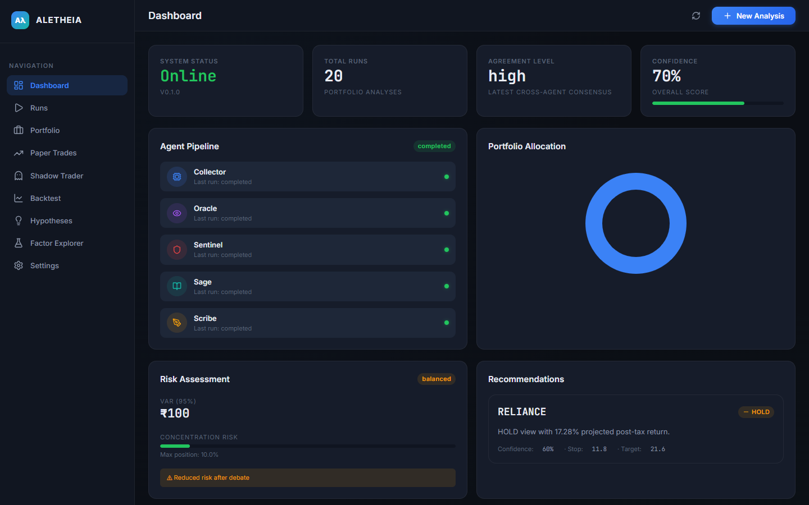
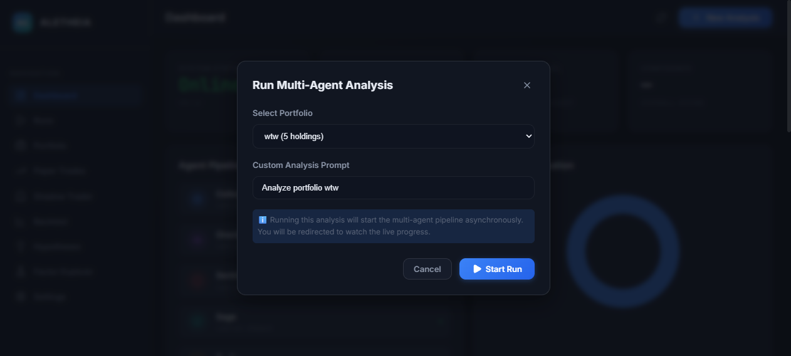
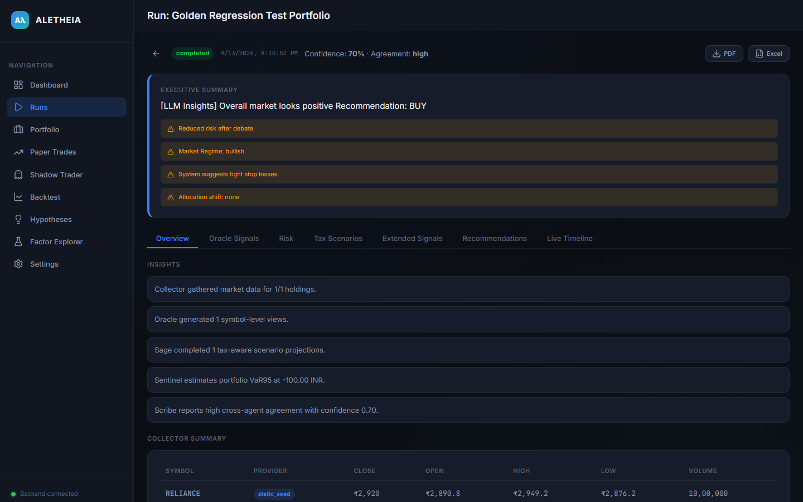
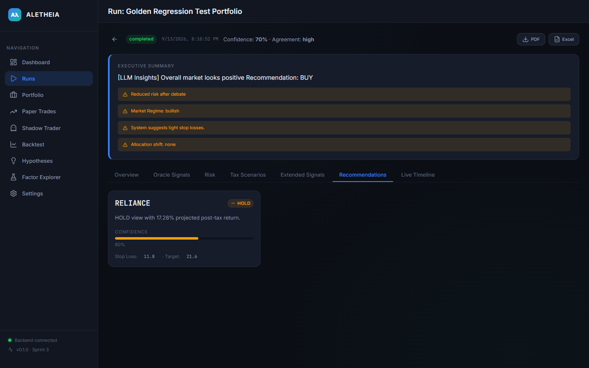
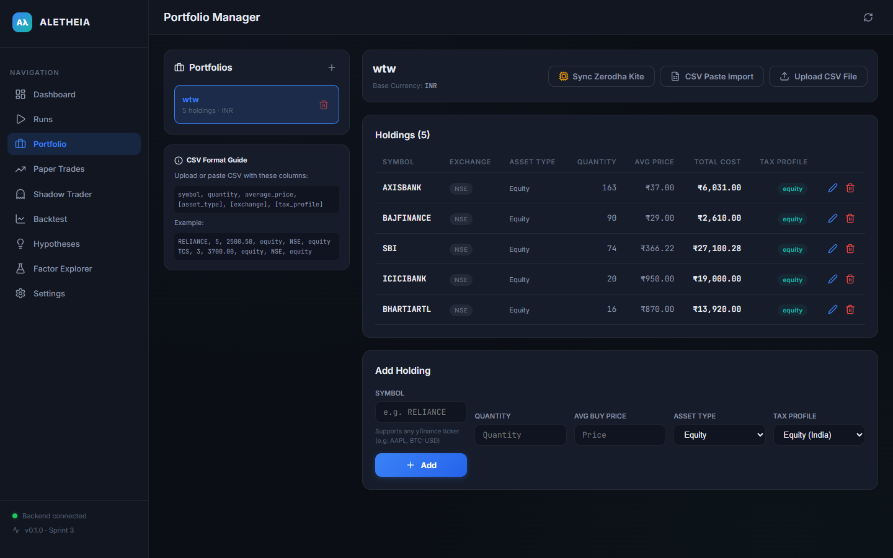
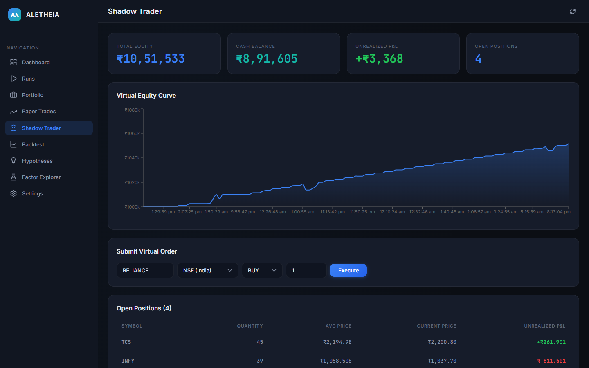
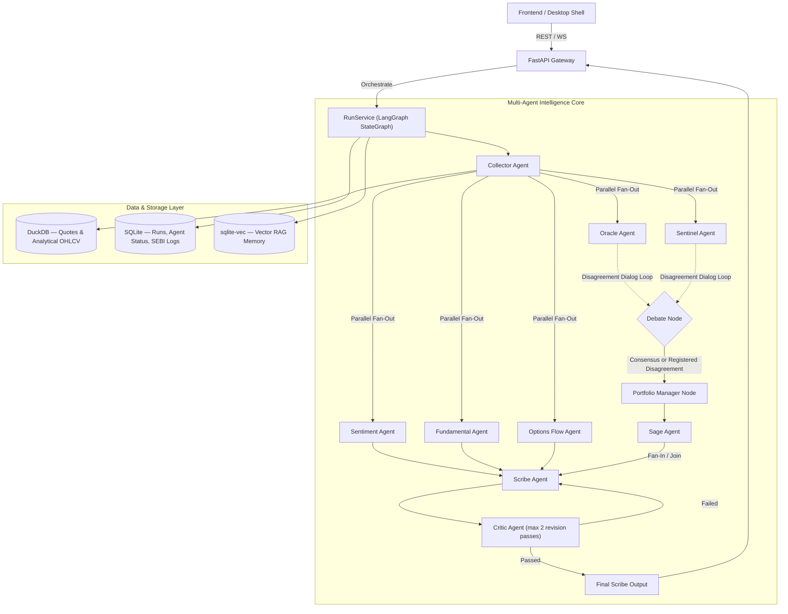

# Aletheia

<p align="center">
  <a href="#"></a>
  <a href="#"></a>
  <a href="#"></a>
  <a href="#"></a>
  <a href="#"></a>
  <a href="#"></a>
  <a href="#"></a>
  <a href="#"></a>
</p>

**Aletheia** is a local-first, open-source, multi-agent financial intelligence platform for the **Indian stock and crypto markets**. It runs local LLMs (via Ollama) alongside heuristic and Rust-backed mathematical engines to gather market data, assess risk, calculate tax drag, and synthesize actionable, India-specific investment analysis — all while keeping your portfolio data on your own machine.

The architecture separates an authoritative **Python/FastAPI** agentic core, high-performance calculations in **Rust** (a PyO3 extension plus a standalone Axum sidecar), and a **React/Vite** frontend packaged inside a **Tauri** desktop shell.

> **Alpha software — not financial advice.** Aletheia is an experimental research tool. Its signals, risk figures, tax scenarios and BUY/HOLD/REDUCE calls are generated by heuristics and language models that can be wrong, and they are for informational and educational purposes only. They are not investment, tax, legal or accounting advice and not a recommendation to buy or sell any security. Verify everything independently, consult a SEBI-registered adviser before acting, and use paper trading only — live broker execution is not implemented. You are solely responsible for your own decisions; see the [LICENSE](LICENSE) for the warranty disclaimer.

---

## Table of Contents

- [Quickstart](#quickstart)
- [Using Aletheia](#using-aletheia)
- [Screenshots](#screenshots)
- [Meet the Agents](#meet-the-agents)
- [Multi-Agent Orchestration Flow](#multi-agent-orchestration-flow)
- [Agent Org-Chart Discipline](#agent-org-chart-discipline)
- [Resilience & Production Hardening](#resilience--production-hardening)
- [Architecture & Tech Stack](#architecture--tech-stack)
- [Project Status & Roadmap](#project-status--roadmap)
- [What's Left](#whats-left)
- [Known Limitations](#known-limitations)
- [Developer CLI & API Quick Look](#developer-cli--api-quick-look)
- [Contributing](#contributing)
- [License](#license)

---

## Quickstart

```bash
docker compose up
```

That's it — no API keys required. This brings up the FastAPI backend, the Rust compute sidecar, the frontend, and an empty Ollama instance. Without pulling a model, you still get the full dashboard, runs list, portfolio manager, backtest, hypotheses, and factor explorer pages, and even end-to-end agent runs — LLM-backed nodes fall back to a templated summary instead of failing the run when Ollama has no model loaded. For real LLM-synthesized analysis, pull a model once:

```bash
docker compose exec ollama ollama pull mistral:7b
```

Prometheus + Grafana dashboards are opt-in (they add two containers nobody needs for the core app):

```bash
docker compose --profile observability up
```

Grafana defaults to `admin`/`admin` locally — set a real `GRAFANA_ADMIN_PASSWORD` in `.env` before exposing port 3000 beyond your own machine.

For local (non-Docker) development — Poetry, the Rust toolchain, and per-suite test commands — see [CONTRIBUTING.md](CONTRIBUTING.md).

### Running without Docker

```powershell
# One-time setup
.venv\Scripts\Activate.ps1
cd aletheia_rust && .venv\Scripts\python.exe -m maturin develop && cd ..
.venv\Scripts\python.exe -m aletheia.cli.main config init

# Three services, three terminals
.\aletheia_engine\target\release\aletheia-engine.exe        # Rust compute sidecar, port 18899
.venv\Scripts\python.exe -m uvicorn aletheia.core.main:app --port 8899   # FastAPI backend
cd frontend && npm install && npm run dev                    # React dashboard, port 5173
```

Or skip the browser entirely and drive the same backend from a terminal dashboard:

```powershell
.venv\Scripts\python.exe -m aletheia.cli.main tui
```

---

## Using Aletheia

A walkthrough of the full loop, in the order you'd actually use it:

1. **Add a portfolio.** Open **Portfolio** and either add holdings one at a time, paste/upload a CSV (`symbol, quantity, average_price, [asset_type], [exchange], [tax_profile]`) — [`docs/sample_portfolio.csv`](docs/sample_portfolio.csv) is a ready-to-use example, or sync from Zerodha Kite (falls back to a mock connector if you haven't configured API keys in **Settings**).
2. **Run an analysis.** Click **New Analysis** from the Dashboard, pick a portfolio, optionally customize the prompt, and start the run. You're redirected to a live view of the pipeline as each agent reports in over WebSocket.
3. **Read the results.** A completed run has tabs for the executive summary and warnings (**Overview**), per-symbol trend signals (**Oracle Signals**), portfolio VaR and concentration risk (**Risk**), STCG/LTCG tax-aware scenarios (**Tax Scenarios**), sentiment/fundamentals/options-flow (**Extended Signals**), per-symbol BUY/HOLD/REDUCE calls with confidence, stop-loss and target (**Recommendations**), and the raw agent-by-agent event stream (**Live Timeline**).
4. **Export a report.** Every run can be exported as a PDF or Excel workbook from the Run Detail page.
5. **Paper-trade the signals.** **Shadow Trader** auto-generates virtual trades from Oracle's signals and tracks a live equity curve; **Paper Trades** lets you submit and settle trades manually against real average-price accounting.
6. **Backtest a strategy.** Pick symbols, a date range, a strategy (`sma_crossover` ships as a starting point), and starting capital on the **Backtest** page to get metrics, an equity curve, and an orders table over historical DuckDB/yfinance data.
7. **Propose and validate a hypothesis.** **Hypotheses** tracks strategy ideas through `proposed → testing → validated/rejected`. Link a hypothesis to a backtest run and it's evaluated automatically against a configurable Sharpe threshold — no manual status flip needed.
8. **Explore alpha factors.** **Factor Explorer** computes technical/statistical factors (RSI, MACD crossovers, Bollinger Bands, volume anomalies) for a symbol on demand.
9. **Configure the system.** **Settings** covers the LLM router (local Ollama or a frontier provider), which market data feeds are enabled, broker API keys (masked once saved), and local storage paths.
10. **Script it.** The `aletheia` CLI (`aletheia --help`) covers setup, ad-hoc analysis, CSV/Parquet import, paper-trade history, benchmarking, run comparison, and database maintenance — see [Developer CLI & API Quick Look](#developer-cli--api-quick-look).
11. **Point an AI assistant at it.** `aletheia mcp` exposes the same tool registry the built-in chat agent uses (market data, backtests, fundamentals, news, portfolio analytics) as an MCP server over stdio — point Claude Desktop's or Cursor's MCP config at it directly.

---

## Screenshots

All screenshots below are from a live local run against demo data — not mockups.

<p align="center"></p>
<p align="center"><em>Dashboard — live agent pipeline status, portfolio allocation, risk assessment, and the latest recommendation, refreshed from the real API.</em></p>

<p align="center"></p>
<p align="center"><em>Starting a new multi-agent analysis run against a saved portfolio.</em></p>

<p align="center"></p>
<p align="center"><em>Run detail — executive summary, warnings, and per-agent insights, with PDF/Excel export.</em></p>

<p align="center"></p>
<p align="center"><em>Per-symbol BUY/HOLD/REDUCE calls with confidence, stop-loss, and target.</em></p>

<p align="center"></p>
<p align="center"><em>Portfolio manager — CSV import, Zerodha sync, and inline holding edits.</em></p>

<p align="center"></p>
<p align="center"><em>Shadow Trader — virtual positions and a real equity curve generated from Oracle's signals.</em></p>

---

## Meet the Agents

1. **The Collector Agent** (Analyst) — normalizes tickers (NSE/BSE formats), fetches market quotes via a provider fallback chain, logs provenance.
2. **The Oracle Agent** (Analyst) — analyzes momentum across multiple timeframes and computes trend signals.
3. **The Sentiment Agent** (Analyst) — classifies NSE corporate announcements and MoneyControl RSS news as bullish/bearish.
4. **The Fundamental Agent** (Analyst) — pulls valuation multiples (P/E, promoter holdings) and flags outliers.
5. **The Options Flow Agent** (Analyst) — parses NSE option chains for Put-Call Ratio, IV Rank, and max-pain levels.
6. **The Sentinel Agent** (Risk) — evaluates portfolio Value-at-Risk (VaR95) and market regime using a Rust-backed hidden Markov model.
7. **The Sage Agent** (Risk) — runs India-specific STCG/LTCG tax projections to estimate tax drag on future gains.
8. **The Scribe Agent** (Synthesis) — synthesizes every agent's output into a report, flagging gaps and disagreements.
9. **The Critic Agent** (Auditor) — reflexion self-audit on the Scribe report; can send it back for revision (max 2 passes).

A **Debate** node re-prompts Oracle and Sentinel with each other's reasoning when they materially disagree, and a deterministic **Portfolio Manager** node enforces exposure/size limits after Sage, able to override an LLM recommendation with the override recorded in the final output.

---

## Multi-Agent Orchestration Flow



---

## Agent Org-Chart Discipline

To keep LLM output from bypassing risk guardrails, agents inherit a strict Pydantic role contract enforced both at class-definition time (`__init_subclass__`) and at runtime (`model_validator`):

| Role Contract | Base Class | Enabled Agents | Mandate |
| :--- | :--- | :--- | :--- |
| **Analyst** | `AnalystContract` | Collector, Oracle, Sentiment, Fundamental, OptionsFlow | May only emit raw quotes, signals, and confidence scores. Forbidden from generating recommendations or decisions. |
| **Risk / Constraint** | `RiskConstraintContract` | Sentinel, Sage | Applies exposure, VaR, and tax-drag constraints. Forbidden from producing recommendations or final synthesis. |
| **Synthesis** | `SynthesisContract` | Scribe | Consolidates all inputs into a final narrative and flags unresolved disagreements. Forbidden from introducing raw, unvalidated market data. |

---

## Resilience & Production Hardening

- **Per-node timeouts** — nodes run inside `asyncio.wait_for` wrappers to bound how long a stalled network call or slow LLM can block a run (see [Known Limitations](#known-limitations) for a real caveat here).
- **Partial-failure handling** — Scribe produces a report noting data gaps when non-critical agents fail rather than aborting the whole run.
- **Rate limiting** — API endpoints are protected by a token-bucket rate limiter.
- **Append-only SEBI log** — every emitted recommendation is stored in an append-only SQLite table with triggers that block deletion/update, plus a SHA-256 hash chain so tampering that bypasses the triggers via raw file access is still detectable (`GET /api/v1/compliance/verify`).
- **Encryption at rest** — API payloads and intermediate run state stored in SQLite are encrypted.

---

## Architecture & Tech Stack

- **Backend:** Python 3.11+, FastAPI, LangGraph, Pydantic v2
- **Performance:** Rust — a PyO3 extension (`aletheia_rust`, portfolio optimization, HMM regimes, options Greeks, tax math) and a standalone Axum HTTP sidecar (`aletheia_engine`, releases the Python GIL; `ComputeClient` falls back to the PyO3 path automatically if the sidecar is offline)
- **Database:** SQLite (system state/runs/SEBI logs), DuckDB (analytical market data), `sqlite-vec` (vector RAG memories)
- **Frontend:** React 19, TypeScript, Vite — 10 pages (Dashboard, Runs, Run Detail, Portfolio, Backtest, Hypotheses, Factor Explorer, Paper Trades, Shadow Trader, Settings), hand-rolled CSS, dark-mode only
- **Desktop Wrapper:** Tauri v2 — auto-launches both sidecars, health-gated window reveal, system tray, and a real frozen-binary installer build (PyInstaller + staged Rust binary, no dev-tree dependency)
- **Local LLM:** Ollama (`mistral:7b` by default; `qwen3.5:9b` and others work too); OpenAI, Anthropic, and Gemini are supported as frontier fallbacks through the same LLM router

---

## Project Status & Roadmap

Aletheia is under active development. This table reflects the actual code as of this update, not carried-forward status from earlier docs — every row below was checked against source, not assumed.

| Area | Status | Detail |
| :--- | :--- | :--- |
| Skeleton & data layer | Done | Monorepo layout, Pydantic schemas, provider chain (static seed → yfinance → CCXT) |
| Engine foundations | Done | LangGraph orchestration, heuristic agents, Rust/PyO3 math backend |
| Resilience & org-chart | Done | Per-node timeouts, partial-failure tolerance, Pydantic role contracts, Debate/PM nodes |
| Rich frontend & live streaming | Done | React UI, WebSocket agent-reasoning stream, desktop (Tauri) app; dark-mode only, no light theme |
| Intelligence upgrade | Done | sqlite-vec RAG memory, news sentiment classifier, options-chain metrics, Scribe-Critic loop |
| LLM integration | Done (basic) | Ollama local models, multi-provider router with retry/circuit-breaker, CLI setup wizard |
| Frontend wired to real APIs | Done | All 10 pages (including Backtest and Hypotheses) call real endpoints — none are placeholders |
| Shadow account / paper trading | Done | Auto-generated virtual trades from Oracle signals, real equity curve, settlement |
| Hypothesis lifecycle | Done | State machine plus automatic Sharpe-threshold evaluation against a persisted backtest result — no manual step needed |
| Live market feed | Done, narrower than originally scoped | A watchlist poller (`MarketFeedPoller`) runs the existing provider chain on a schedule and streams quotes over an internal event bus to a `/ws/market-feed` endpoint. This is polling through the same providers as a normal run, not a raw low-latency exchange WebSocket, and there's no NSE/BSE-specific real-time source yet |
| PDF/Excel report export | Done | Jinja2 + WeasyPrint (HTML fallback if not installed) + openpyxl |
| Terminal dashboard | Done | `aletheia tui` — portfolio, live run streaming, paper trades, recent runs |
| Swarm presets | Done | `investment_team`/`quant_team` presets wired to `/api/v1/swarm/presets` and `/api/v1/swarm/run` |
| Desktop packaging | Done | Frozen backend (PyInstaller) and the Rust sidecar are staged into the Tauri bundle's `resources/`, producing an installer with no dev-machine dependency |
| Docker Compose | Done | Ships `backend`, `engine`, `ollama`, `frontend`, plus opt-in `prometheus`/`grafana` — this is what the Quickstart above actually runs |
| Kubernetes / Helm | Partial | Deployment, Service, HPA, liveness/readiness probes, and a Helm ConfigMap are real; there's no Helm Secret template yet (assumes one is provisioned externally) |
| Full MCP server | Done | All registered tools exposed over stdio; verified against a real `tools/list` handshake, works with Claude Desktop / Cursor |
| Multi-swarm specialist tuning, domain fine-tuning, live broker orders | Not started | See [What's Left](#whats-left) |

---

## What's Left

Gaps that are either fully unbuilt or real but incomplete, roughly in order of impact:

- **NSE/BSE-specific live data.** The current live feed reuses the standard provider chain on a timer; a genuine low-latency exchange source (e.g. Angel One SmartAPI, jugaad-trader) isn't integrated.
- **Tauri deep links and native notifications.** `aletheia://run/{id}` and OS-level "run complete" notifications are not wired up — sidecar auto-launch, tray, and installer packaging are done, these two plugins aren't added yet.
- **Live broker execution.** `aletheia/extensions/brokers/zerodha.py` is explicitly a blueprint: `get_account_balance`/`place_order`/`cancel_order` wrap the `kiteconnect` SDK, but there's no OAuth (`generate_session`/`request_token`) flow, so it can't place a real order yet. This touches real money and should stay staged behind paper mode until it's finished properly.
- **Options pricing widget.** Black-Scholes/Greeks are already computed server-side in Rust; nothing in the frontend exposes them yet.
- **Helm Secret template.** `deployment.yaml` references an `aletheia-secrets` Secret via `secretKeyRef`, but nothing in the chart creates it — fine if you provision it externally, but that's not documented anywhere in the chart itself.
- **Light theme and a real mobile pass.** The design system is dark-mode only (`color-scheme: dark` is hard-coded), with two basic responsive breakpoints and no dedicated mobile layout work.
- **Multi-swarm specialist tuning.** The `investment_team`/`quant_team` presets exist and run, but the originally-scoped `crypto_team`/`macro_team`/`smallcap_team` tuning (different metrics/thresholds per asset class) hasn't been started.
- **Domain fine-tuning.** Training a model on NSE/BSE filings and earnings-call transcripts (the long-term "moat" idea) hasn't been started.
- **Event bus, fully wired.** `EventBus` is real, tested, and now feeds the live market-feed WebSocket, but the run-event path (WebSocket router, audit log) still goes through the original SQLite-store-and-replay mechanism rather than the bus.

---

## Known Limitations

- **Very large local models on slow hardware can still hit the per-node timeout.** The default `node_timeout_secs` is 120 seconds (it was 30 in 0.1.0, which was too tight: Collector fans out to five analyst agents that all queue on a single local Ollama instance, so with a 9B-class model on modest hardware later nodes exceeded it and runs came back `partial`). If a run still comes back `partial` with agents marked failed and nothing is actually broken, raise `ALETHEIA_NODE_TIMEOUT_SECS`.

---

## Developer CLI & API Quick Look

```bash
# CLI: see everything available
aletheia --help
# setup, analyze, run, import-data, info, tui, mcp, serve, memory,
# config, paper-trades, benchmark, compare, db

# Analyze a portfolio
POST /api/v1/runs
{
  "prompt": "Analyze an India-first starter portfolio",
  "portfolio": {
    "name": "Starter",
    "holdings": [
      { "symbol": "RELIANCE", "quantity": 5, "average_price": 2500, "asset_type": "equity", "exchange": "NSE", "tax_profile": "equity" }
    ]
  }
}

# Query SEBI compliance logs
GET /api/v1/compliance/log?limit=20

# Search vector memory (RAG)
GET /api/v1/memory/vector-search?q=Reliance

# Export a run
GET /api/v1/runs/{run_id}/export?format=pdf|excel
```

The full REST surface (49 endpoints as of this update, plus WebSocket streams for run events and the live market feed) is documented via the running backend's OpenAPI schema at `http://localhost:8899/docs`. Detailed onboarding docs, threat models, and architectural guides are in the [docs/](docs/) directory.

### Test Suites

306 Python tests, 32 Rust tests (21 in `aletheia_rust`, 11 in `aletheia_engine`), 8 frontend tests — all passing as of this update. CI (`.github/workflows/ci.yml`) runs lint, format, mypy (baseline-gated), dependency audits, and all three suites as real blocking gates.

```bash
.venv\Scripts\pytest tests/ -v          # Python
cargo test -p aletheia_rust             # Rust — PyO3 module
cd aletheia_engine && cargo test        # Rust — compute sidecar
cd frontend && npm test                 # Frontend
```

---

## Contributing

See [CONTRIBUTING.md](CONTRIBUTING.md) for dev setup, how to run the Python/Rust/frontend test suites, and PR expectations.

---

## License

Aletheia is open-source software licensed under the MIT License. See [LICENSE](LICENSE) for details.
