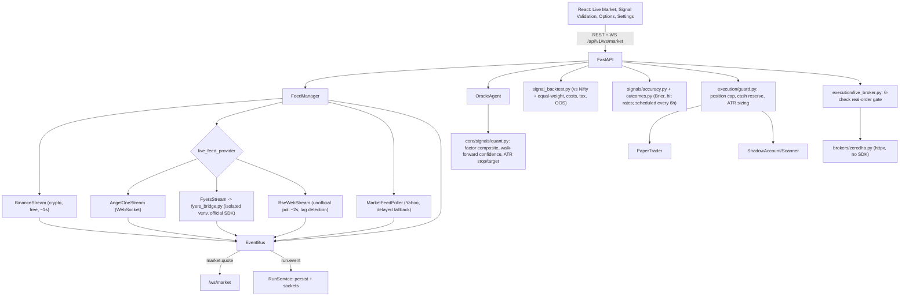

# Aletheia: Project State and Handoff

**Read this first.** It is the single source of truth for where the project stands. `CLAUDE_CODE_HANDOFF.md`
(2026-09-03) and `docs/KNOWLEDGE_GRAPH.md` (2026-06-27) predate most of this work; trust this file where they disagree.

- **Last updated:** 2026-10-25 (end of a long working session)
- **Git state:** the work was committed as `171e615` (129 files) on `feat/live-data-and-signal-validation`, then **fast-forwarded into `main` and pushed to `origin/main` on the owner's instruction** (2026-10-25). `main` is protected by the repo's `no-commit-to-branch` pre-commit rule, so commits go on a feature branch and `main` is only fast-forwarded (`git fetch . <branch>:main` works even when a dirty working tree blocks `git switch main`). CI runs on `main` pushes: check it with `gh run list --branch main`.
- **Left uncommitted on purpose:** `frontend/tsconfig.tsbuildinfo` and the four `desktop/src-tauri/gen/schemas/*.json` files (build artifacts that only show line-ending churn after each build).
- **Update this file** when you finish meaningful work, and keep claims honest (see "Rules for the next session").

---

## 1. Rules for the next session

These come from the repo owner (`CLAUDE.md`, and preferences stated during this work).

1. **Do not commit until the owner says so.** They want a body of work finished, then one commit. No `Co-Authored-By` or AI attribution trailer (`CLAUDE.md` overrides any default). Commit on a feature branch, never `main`. The repo's pre-commit hooks are **not installed in `.git/hooks`**, so run them by hand before committing: `.venv\Scripts\pre-commit.exe run --files $(git diff --cached --name-only)` (ruff, format, secrets, whitespace). `.secrets.baseline` was refreshed in `171e615`; if `detect-secrets` flags field names or fake test fixtures, review each line, then `.venv\Scripts\detect-secrets.exe scan --baseline .secrets.baseline`.
2. **Be honest about verification.** The owner values "works / doesn't work / unverified" over optimism. This session's most useful catches came from testing against the real service or a real browser, not mocks (see section 7).
3. **Never `pip install` a vendor SDK into `.venv`.** `fyers-apiv3` downgraded `requests`/`aiohttp` (breaking `ccxt`) and added boto3 and a bogus `asyncio` package. To read an SDK: `pip download <pkg> --no-deps` and unzip the wheel. If needed at runtime, use an isolated venv. Run `pip check` after any install and compare with `poetry.lock`.
4. **The owner does not want to open a broker account right now** and prefers free, no-signup sources. Broker paths are built for later.
5. **Windows environment.** Use `.venv\Scripts\python.exe` and `.venv\Scripts\pytest` (see `CLAUDE.md`). The Bash tool breaks on very large heredocs and on triple-quote content: write scripts with the file-write tool, then run them. `ruff --fix` deletes imports that are not yet used (re-add them if you append tests later). Never kill processes by command-line pattern from a shell whose own command line matches the pattern (it kills itself); kill by port.
6. **Frontend gate before saying "done":** `npx tsc -b`, `npx vitest run`, `npm run build` inside `frontend/`. **Backend gate:** pytest, `ruff check`, `ruff format --check`, mypy baseline filter, `pip check`.

---

## 2. Status at a glance

| Area | State | How it was verified |
|---|---|---|
| Whole app (backend + frontend) | Works | 491 backend tests (5 skipped), 58 frontend tests, build; backend and frontend started and driven in a real browser |
| Crypto per-second feed (Binance) | **Works, verified live** | Real service: ~1.0 update/s, ~0.08 s event-to-arrival, price within 0.15% of Yahoo; watched moving in the browser |
| Stock prices, default | Works, **delayed** (Yahoo) | Real quotes in the UI |
| BSE website stock feed | Works technically; **real-time-ness UNVERIFIED** | Real BSE API returns quotes for all test symbols; market was closed. Needs `scripts/bse_check.py` on a trading day |
| Angel One stream | Built; **never run on a real login** | Tests with simulated frames; protocol from their SDK |
| Fyers stream | Built; **never run on a successful login** | Real SDK installed in an isolated venv and run with a bad token (auth failure handled); tick path tested with an SDK stand-in |
| Zerodha OAuth + live orders | Built, **off by default, untested on a real account** | Mocked HTTP only. No UI button for live orders on purpose |
| Oracle signal quality | **FAILS its backtest** | See section 3 |
| Paper/shadow trading risk limits | Works | Unit + integration tests |
| Options pricing page | Works | Tests; Black-Scholes parity checks |
| Light theme, chart on click | Works | Tests + real browser |
| Tauri desktop (notifications, `aletheia://` deep links, single-instance) | Compiles; **never launched** | `cargo check` only |
| Packaged desktop installer | Not rebuilt | Fyers helper venv would not be present in a frozen build |

---

## 3. Findings that must not be forgotten

1. **The Oracle's BUY/REDUCE signal does not beat holding Nifty.** Walk-forward backtest on 24 Nifty large caps (Apr 2020 to Oct 2026), next-day fills, commission + spread + slippage + STT, Indian capital-gains tax: **~0.5 to 1.8% CAGR vs Nifty 15.2% vs equal-weight of the same stocks 19.8%**; out-of-sample last 40% lost ~6% a year while Nifty made ~1%. Five fixed variants (slower rebalance, wider/no stops, fewer positions, zero costs) all failed to beat Nifty; even zero costs gave only ~6%. Universe is today's large caps (survivorship bias), which flatters results. **Do not present signals as reliable; do not tune on the same data to manufacture a pass.** Harness: `aletheia/extensions/backtest/signal_backtest.py`, UI page "Signal Validation".
2. **Per-second NSE data has no free, legitimate, no-account source.** NSE's website returns 403 to scripts (even after cookie priming); Yahoo is delayed. `docs/FREE_LIVE_DATA.md` lists every source tested and why it fails. The closest free option is the unofficial BSE poller.
3. **The static demo-price provider used to be first in the chain** and silently served hardcoded 2024 prices for RELIANCE/TCS/INFY/HDFCBANK/ICICIBANK/SBIN in real runs. It is now opt-in (`ALETHEIA_STATIC_SEED_ENABLED`) and last.
4. **Test isolation bug (fixed):** integration tests wrote to the developer's real `./data/execution.sqlite3` (a RELIANCE paper position grew by a share per run; 63 shares now). `tests/conftest.py` now points all data paths at a throwaway temp dir before importing `aletheia`. **The real `data/execution.sqlite3` still contains ~63 test-created paper trades; left in place pending the owner's say-so.**
5. TradingView's free embed widget **does not show NSE symbols** ("only available on TradingView"), hence the chart uses the open-source Lightweight Charts library.

---

## 4. Architecture added this session

Original system (LangGraph agents Collector/Oracle/Sentinel/Sage/Scribe/Critic, Rust sidecar, FastAPI, React, Tauri) is described in `README.md` and `CLAUDE_CODE_HANDOFF.md`. Added or changed:



### Where things live

| Concern | Files |
|---|---|
| Deterministic signal | `aletheia/core/signals/quant.py` (composite from `aletheia/factors`, walk-forward hit-rate confidence, ATR stop/target; no data -> HOLD at 0.0, never synthetic prices), `outcomes.py` (scores past predictions; wired in `core/main.py` lifespan), `accuracy.py` |
| Oracle | `extensions/agents/oracle.py`: signal comes from quant; LLM only comments (`[LLM Dissent]`); debate can only de-risk |
| Backtest of the signal | `extensions/backtest/signal_backtest.py` (no look-ahead: decisions on bars <= t, fills at t+1 open; per-FY tax; OOS split; verdict PASS/FAIL/INCONCLUSIVE) |
| Risk limits | `core/execution/guard.py` (wraps existing `portfolio_constraints.py`); applied in `paper_trader.py`, `shadow_account/account.py`, `scanner.py`; rejected orders -> HTTP 422 |
| Live feed | `core/marketdata/feed_manager.py` (owns streams), `live_feed.py` (poller), `watchlist.py`, `hours.py` (IST hours, weekday-only, no holidays), `candles.py` (Yahoo OHLCV for charts) |
| Stream clients | `extensions/data/{angel_session,angel_stream,binance_stream,bse_web_stream,fyers_stream,fyers_bridge}.py`, `providers/angel_one_provider.py` |
| Broker auth/orders | `extensions/brokers/{zerodha,zerodha_session,fyers_session}.py`, `core/execution/live_broker.py` |
| Event bus | `core/events/bus.py`; `RunService.record_event` emits `run.event`; persistence and WebSocket fan-out are subscribers (`core/services.py`) |
| New routers | `routers/{brokers,feed,options,signals}.py`; also `execution.py` (+live-order), `websocket.py` (snapshot on connect) |
| Frontend | `pages/{LiveMarket,SignalValidation,Options}.tsx`, `components/PriceChart.tsx`, `lib/{useMarketFeed,chartBars,theme,desktop,tradingview}.ts`, Settings additions, theme toggle in `TopBar` |
| Desktop | `desktop/src-tauri` (notification, deep-link, single-instance plugins; `capabilities/default.json`) |
| Swarm presets | `core/swarm/presets.py`: added `quant_team`, `crypto_team`, `macro_team`, `smallcap_team` |

### New HTTP/WS surface (all under `/api/v1`)

`GET/PUT /watchlist`, `GET /marketdata/{feed-status,snapshot,candles}`, `WS /ws/market`, `GET /signals/accuracy`, `GET /signals/shadow-vs-nifty`, `POST /backtest/signal`, `GET /backtest/signal/latest`, `GET /options/price`, `GET /brokers/{zerodha,fyers}/{status,login-url}`, unauthenticated OAuth callbacks `GET /brokers/{zerodha,fyers}/callback` (single-use `state` nonce), `POST /execution/live-order`, `GET /execution/live-orders`.

### Frontend routes added
`/live` (Live Market), `/validation` (Signal Validation), `/options`.

---

## 5. Live-data matrix and switches

| Source | Switch | Account | Cadence | Notes |
|---|---|---|---|---|
| Binance public WS (crypto) | on by default; `ALETHEIA_CRYPTO_STREAM_ENABLED=false` to stop | none | ~1 s | Only connects if the watchlist has a crypto pair. Open/high/low/volume/change are Binance's rolling **24h** figures |
| BSE website (stocks) | `ALETHEIA_LIVE_FEED_PROVIDER=bse_web` (Settings dropdown) | none | poll 2 s (floor 1 s, 8 req/s cap, backoff) | **Unofficial.** BSE prices, no volume. Each quote carries BSE's own "as on" time; UI shows "exchange data N min old" and a red banner past 3 min. Symbols map via BSE `scrip_id` |
| Angel One | `ALETHEIA_LIVE_FEED_PROVIDER=angel_one` + `ALETHEIA_ANGEL_ONE_ENABLED=true` + 4 saved credentials | yes | ~1 s | No daily login (TOTP). `docs/ANGEL_ONE_SETUP.md`; check with `scripts/angel_check.py` |
| Fyers | `ALETHEIA_LIVE_FEED_PROVIDER=fyers` | yes | ~1 s | Daily browser login (token expires 06:30 IST). Needs `scripts/fyers_setup.py` once (creates `~/.aletheia/fyers-venv`). NSE only. `docs/FYERS_SETUP.md`; `scripts/fyers_check.py` |
| Yahoo | default fallback | none | `ALETHEIA_MARKET_FEED_INTERVAL_SECS` (15 s) | Delayed |

Facts discovered while building (re-verify if relied on): Angel One WS `wss://smartapisocket.angelone.in/smart-stream`, prices in paise (stream self-checks against REST and corrects the divisor); Fyers real SDK returns code **-300 "Please provide valid token"** for a bad token and still fires `on_connect`, so "connected" is only trusted after the `{"type":"cn","code":200}` auth ack; Binance `@ticker` pushes 1/s per symbol on `wss://stream.binance.com:9443/stream` (fallback `data-stream.binance.vision`).

---

## 6. Safety rails (real money)

`POST /execution/live-order` sends a Zerodha order only if **all** hold, checked before any network call and logged either way: `ALETHEIA_LIVE_TRADING_ENABLED=true`; `ALETHEIA_API_KEYS` set; execution mode `live` and not paused, with paper trades on >= 7 **distinct days measured server-side** (the caller's claim is ignored); `confirm: true`; whole shares <= `LIVE_MAX_ORDER_QTY` (500), value <= `LIVE_MAX_ORDER_VALUE` (INR 25,000), <= `LIVE_MAX_ORDERS_PER_DAY` (10); NSE/BSE delivery (CNC) MARKET/LIMIT only. No UI button. Never exercised against a real account; first real use must be 1 share, small limit order.

Paper/shadow limits (`ExecutionGuard`): position cap = `pm_max_position_size_pct` (20%), cash reserve `pm_min_cash_reserve_pct` (5%), sizing = `risk_per_trade_pct` (1%) to the ATR stop, `paper_starting_cash` INR 1,000,000. Selling an unheld symbol is rejected (it used to credit fake cash). Sector caps are not applied to paper/shadow (positions carry no sector).

---

## 7. Lessons from real-service/browser testing (why to keep doing it)

These bugs were invisible to unit tests: TradingView widget refuses NSE; Fyers `-300` auth code and the misleading `connected`; the global error handler turned any custom-validator failure into HTTP 500 (`Object of type ValueError is not JSON serializable`); a watchlist reader that treated a Pydantic model like a dict (saved watchlists silently reverted); sorted-vs-set subscription order flakiness; integration tests polluting real data; Zerodha sync inserting **mock holdings** on a real failure and passing the API **secret** as the access token (both fixed).

---

## 8. Runbook

```powershell
# Backend (from C:\Aletheia)
.venv\Scripts\python.exe -m uvicorn aletheia.core.main:app --port 8899
# Frontend (from C:\Aletheia\frontend)
npm run dev            # http://localhost:5173  (Live Market at /live)

# Backend gate
.venv\Scripts\pytest tests -q -p no:cacheprovider          # 491 passed, 5 skipped at last run
.venv\Scripts\python.exe -m ruff check aletheia tests scripts
.venv\Scripts\python.exe -m ruff format --check aletheia tests scripts
.venv\Scripts\mypy.exe aletheia | .venv\Scripts\mypy-baseline.exe filter    # must EXIT 0 (check `$?`); printing nothing is not enough: it also fails on resolved violations, fix with `mypy-baseline sync`
.venv\Scripts\python.exe -m pip check
# Frontend gate (in frontend/)
npx tsc -b ; npx vitest run ; npm run build                 # 58 tests at last run

# Verification scripts (real services)
.venv\Scripts\python.exe scripts\crypto_check.py            # any hour
.venv\Scripts\python.exe scripts\bse_check.py               # Mon-Fri 09:15-15:30 IST: measures BSE lag
.venv\Scripts\python.exe scripts\angel_check.py             # needs Angel One credentials
.venv\Scripts\python.exe scripts\fyers_setup.py             # once; then fyers_check.py
```

Config lives in `.env` (see `.env.example`) and `~/.aletheia/config.json` + keyring (broker credentials, encrypted). Backend reads provider settings **at startup**; restart after changing them. New env vars this session: `ALETHEIA_LIVE_FEED_PROVIDER`, `ALETHEIA_ANGEL_ONE_ENABLED`, `ALETHEIA_CRYPTO_STREAM_ENABLED`, `ALETHEIA_BSE_WEB_POLL_SECS`, `ALETHEIA_STATIC_SEED_ENABLED`, `ALETHEIA_MARKET_FEED_EMIT_INTERVAL_SECS`, `ALETHEIA_CALIBRATION_RESOLVE_INTERVAL_SECS`, `ALETHEIA_LIVE_TRADING_ENABLED`, `ALETHEIA_LIVE_MAX_ORDER_VALUE`, `ALETHEIA_LIVE_MAX_ORDER_QTY`, `ALETHEIA_LIVE_MAX_ORDERS_PER_DAY`.

Dependencies added: Python none (Angel/Zerodha/Fyers-auth use `httpx`; websockets already present); frontend `lightweight-charts`, `@tauri-apps/api`, `@tauri-apps/plugin-notification`, `@tauri-apps/plugin-deep-link`; Rust `tauri-plugin-{notification,deep-link,single-instance}`.

---

## 9. Decisions log

| Decision | Why |
|---|---|
| Oracle signal = deterministic factor composite; LLM only explains | A 7B model's self-reported confidence is uncalibrated; confidence is now the shrunk walk-forward hit rate (capped at 0.55 under 20 samples) |
| Missing history -> HOLD at 0.0 (`data_quality` flag) | Old code invented random prices when data was missing |
| Fyers SDK in an isolated venv + subprocess bridge | Its binary protocol is risky to reimplement untested; its deps break the main env |
| Angel One/Zerodha via direct `httpx`/`websockets`, no SDK | No dependency risk; protocols are simple and documented |
| Lightweight Charts, not the TradingView widget | Widget cannot show NSE; library is open source and takes our own data |
| BSE poller reports exchange lag instead of claiming "live" | Cannot know if BSE's public data is real-time; the UI should show the truth |
| Stream "connected" only after the broker's auth ack | Fyers SDK reports connected even after a failed login |
| Run events through the EventBus; per-service private bus by default | Persistence/WebSocket become subscribers; tests stay isolated; the app injects the global bus |
| Tests isolated from `./data` via `tests/conftest.py` | Real data was being polluted and the guard would eventually fail the tests |

---

## 10. Open items, in priority order

1. **Check CI on `main`** (`gh run list --branch main`). The first push of this work failed only the mypy-baseline gate (stale resolved entries); that was fixed in a follow-up commit. Confirm it is green.
2. **Monday trading day:** run `scripts\bse_check.py`. Lag 0 to 1 min = BSE feed is genuinely live; several minutes = delayed (keep it only as a labelled convenience). Record the result in section 2 and `docs/FREE_LIVE_DATA.md`.
3. **Optional cleanup:** clear the ~63 test-created paper trades in `data/execution.sqlite3` (ask the owner first; it is their local data).
4. **When a broker account exists:** run `scripts\angel_check.py` in market hours first (no daily login, packaged-app friendly) and record results; Fyers is the fallback. Then verify Zerodha orders with 1 share.
5. **Signals:** if pursuing edge, test new ideas through the same harness (cross-sectional momentum, simple trend filter); get point-in-time Nifty constituents to remove survivorship bias; do not tune on one period.
6. **Desktop:** launch the Tauri app once to confirm notifications and `aletheia://run/<id>` links; rebuild the installer (the Fyers helper venv will not exist in a frozen build).
7. **Known gaps:** `hours.py` has no exchange holidays; BSE source has no volume; Fyers NSE-only and 100-symbol plan limit; `quant_team` etc. presets only have prompt-level tuning (no per-asset-class metrics); domain fine-tuning and a real mobile layout are not started.

---

## 11. Documentation map

`README.md` (user-facing, "Live data & broker orders" section) · `CHANGELOG.md` (`[Unreleased]` has all of the above) · `docs/FREE_LIVE_DATA.md` (sources tested) · `docs/ANGEL_ONE_SETUP.md` · `docs/FYERS_SETUP.md` · `docs/ROADMAP.md` and `CLAUDE_CODE_HANDOFF.md` (older; see banners) · `docs/KNOWLEDGE_GRAPH.md` (architecture graph; new section at top) · `SECURITY.md`, `docs/THREAT_MODEL.md`. Claude's own memory notes for this repo live in `C:\Users\abssa\.claude\projects\C--Aletheia\memory\`.
